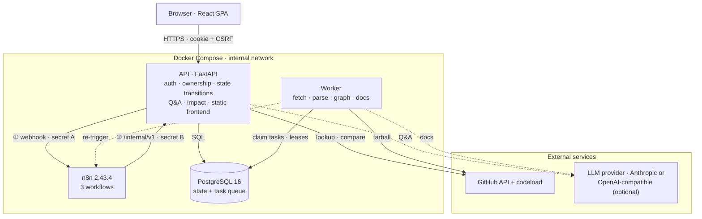
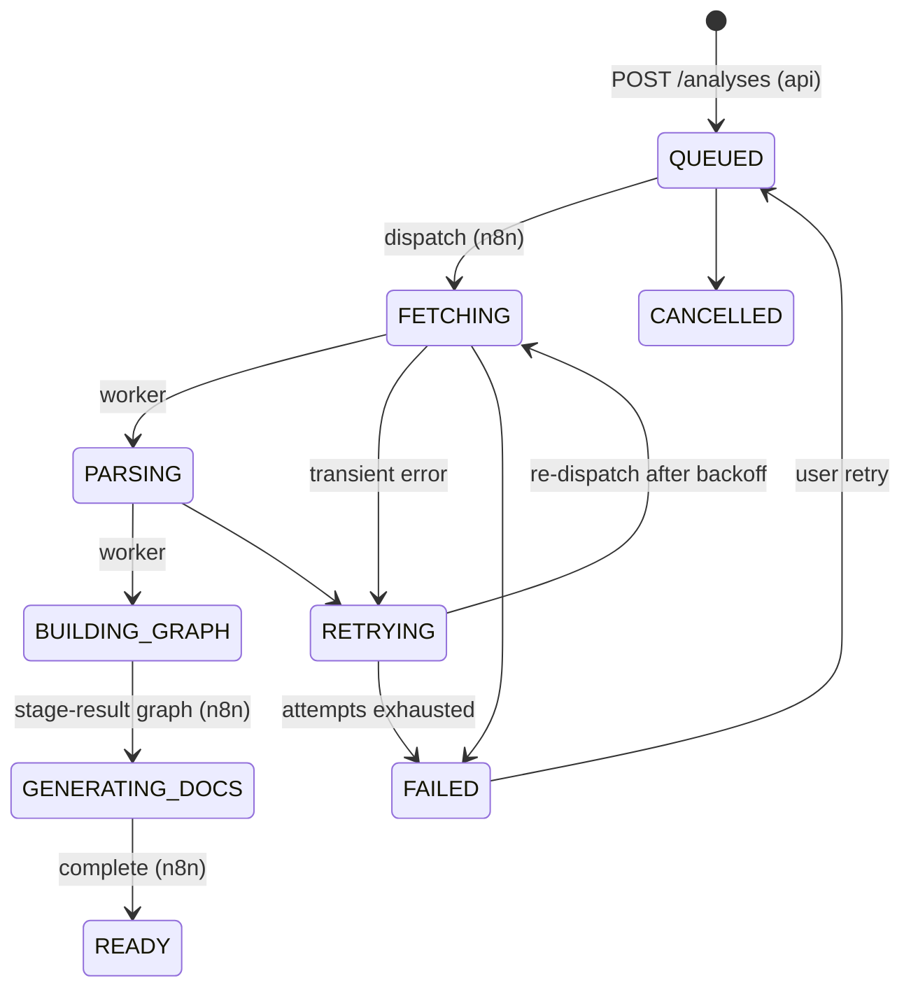
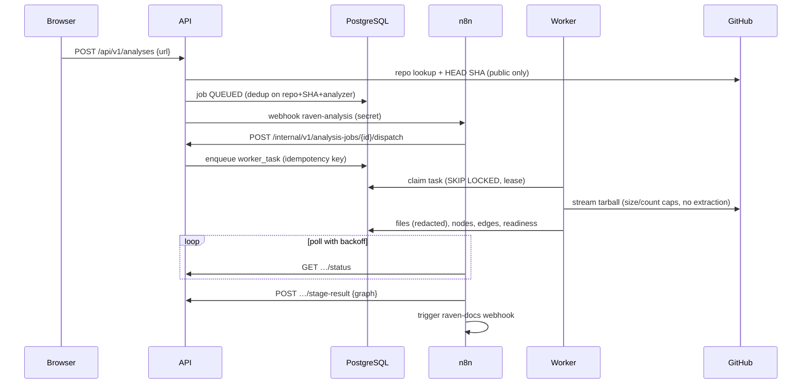
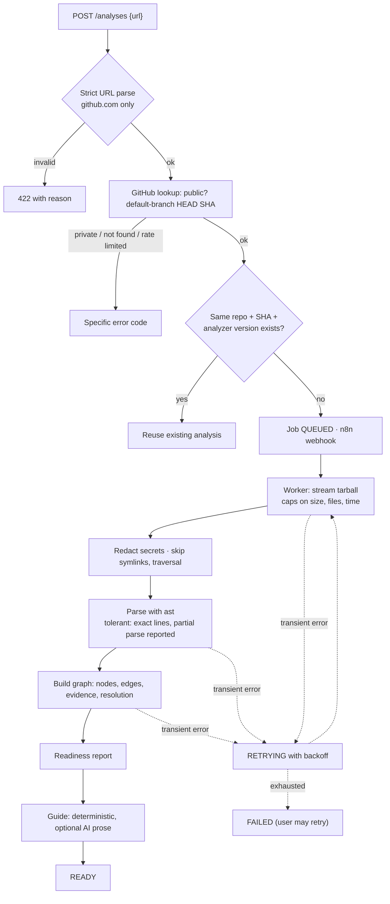
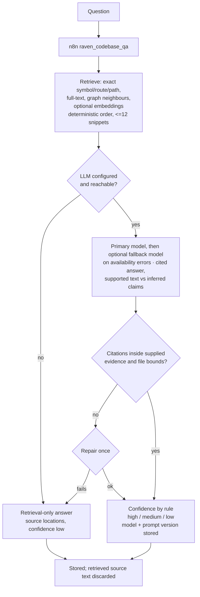
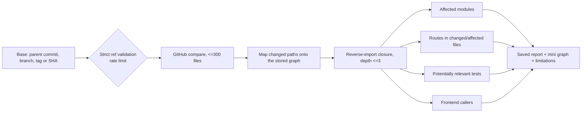
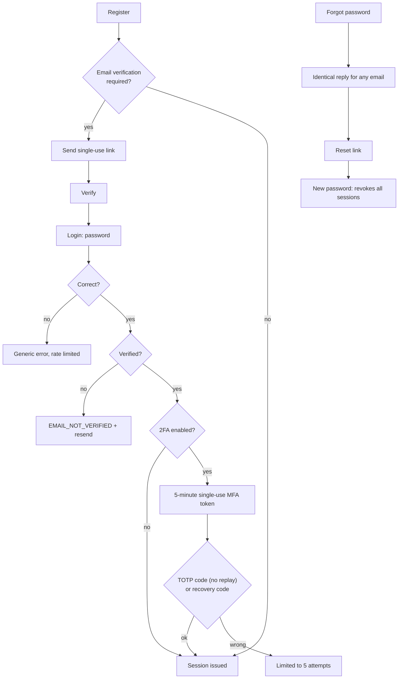
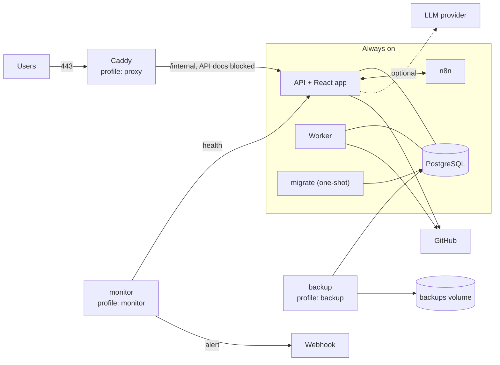
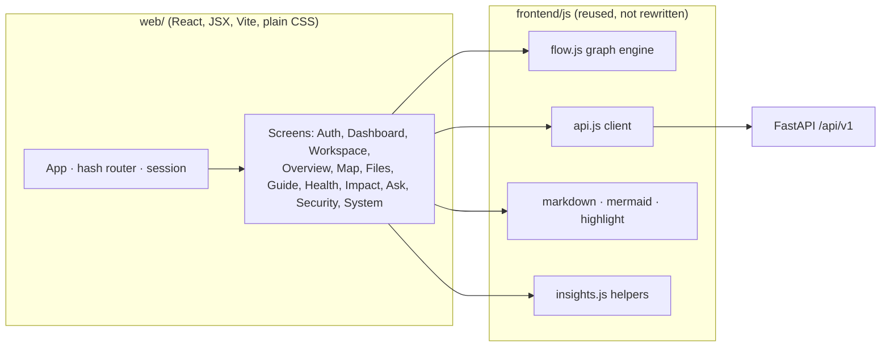

# Raven — Architecture & Workflows

> Related: [Product](../product/PRODUCT.md) · [Evaluation & Results](../evaluation/EVALUATION_AND_RESULTS.md) · reference: [SECURITY](../SECURITY.md), [N8N](../N8N.md), [DEPLOYMENT](../DEPLOYMENT.md)

## 1. System overview
Five containers (Docker Compose): **api**, **worker**, **postgres**, **n8n**, and a one-shot **migrate** (Alembic). The React frontend (built with Vite) is served by the API; a legacy vanilla-JS UI remains at `/legacy`. PostgreSQL is both the system of record **and** the work queue. n8n orchestrates but owns no state and holds no GitHub or LLM credentials.

Secret A = `N8N_WEBHOOK_SECRET` (API → n8n), secret B = `INTERNAL_SERVICE_SECRET` (n8n → API). Dotted arrows are optional/conditional: LLM calls happen only with an API key; the worker re-triggers n8n only if a trigger was not acknowledged within 90 s. Static image: [images/architecture.png](../images/architecture.png). Only `api` (8000) and the n8n editor (5678) are published, both bound to `127.0.0.1`.

| Component | Code | Owns |
|---|---|---|
| API | `backend/app/api`, `services` | sessions, CSRF, ownership checks, URL/ref validation, every state transition, rate limits and daily quotas (`services/quotas.py`), Q&A retrieval + answer validation + answer cache, impact computation, architecture map (`services/codemap.py`, `services/areas.py`), pull-request review (`services/pr_review.py`), admin API, HTTP metrics (`core/metrics.py`), static frontend |
| Worker | `backend/app/workers` | claims `worker_tasks` with leases + heartbeats; runs `analysis`, `docs_explain`, `docs_assemble`; requeues expired leases; re-triggers n8n after 90 s |
| PostgreSQL | `backend/app/models`, `migrations` (8 migrations) | 21 tables: users, auth_tokens, sessions, repositories, analysis_jobs, analysis_transitions, analysis_files, code_nodes, code_edges, documentation, chat_messages, impact_reports, pr_reviews, workflow_runs, worker_tasks, callback_receipts, rate_limit_events, audit_events, admin_events, answer_cache, embedding_cache |
| n8n | `automation/n8n/*.json` (generated by `build_workflows.py`) | the order of steps, waits, retries and timeouts; it only calls `/internal/v1` |
| Frontend | `web/` (React 18, JSX, Vite, plain CSS) · `frontend/js` | Landing, sign-in/up, verify, reset, 2FA, dashboard, Overview, Map, Files, Guide, Health, Impact, Architecture, Ask, Pull requests, System, Admin. Reuses the vanilla graph engine, API client and markdown/Mermaid helpers from `frontend/js`; the previous UI remains at `/legacy` |

## 2. Job state machine (backend-owned)

Illegal transitions return HTTP 409; every legal one is stored in `analysis_transitions` with its actor (`api` / `worker` / `n8n`). A full 9×9 transition matrix is covered by `test_internal_contract.py`. Simplified for readability; the full table is `LEGAL` in `backend/app/services/state.py`. Omitted here: `FAILED`/`CANCELLED` from every active state, `PARSING`/`BUILDING_GRAPH → FETCHING` (crash recovery), and `GENERATING_DOCS ⇄ RETRYING` (docs-stage retry).

## 3. Workflows
### 3.1 Repository analysis (`raven_repository_analysis`)

### 3.2 Documentation (`raven_documentation_generation`)
dispatch `docs_explain` → poll → dispatch `docs_assemble` → poll → `complete`. The worker builds the deterministic 16-section guide; if an LLM is configured it adds schema-validated explanations whose citations must lie inside analyzed files. Budgeted (`MAX_LLM_CALLS_PER_ANALYSIS`, wall-clock limit); exceeding a budget yields a *partial* guide, not a failure.

### 3.3 Q&A (`raven_codebase_qa`, synchronous)
`POST /chat` (API) → n8n webhook → `POST /internal/v1/qa/retrieve` (bounded evidence) → `POST /internal/v1/qa/answer` (API calls the LLM, validates citations, assigns confidence, stores the answer and discards the retrieved source text) → webhook responds → API returns the stored message. If the LLM is unconfigured or fails (401/429/5xx/timeout), the answer is stored as **retrieval-only**.

### 3.4 Readiness, impact, architecture map and pull-request review (no workflow)
- **Readiness** is computed by the worker during the graph stage (`app/analysis/readiness.py`) and stored with the job; `GET /readiness` filters it.
- **Map** (`GET /analyses/{id}/map`) is computed on demand from the stored graph: files are assigned to plain-language areas (`services/areas.py`), grouped, and file-to-file links are lifted from symbol edges (`services/codemap.py`).
- **Pull-request review** compares the base and head analyses (architecture drift, new readiness findings, untested changed modules) and produces a review priority with plain reasons; nothing is posted to GitHub.
- **Impact** runs in the API: `POST /impact` → GitHub compare (≤300 files) → `compute_impact` maps changed paths onto the stored graph → report saved (last 20 kept).

### Reliability properties
- All n8n callbacks carry idempotency keys; duplicates replay the stored response (`callback_receipts`); duplicate dispatch never enqueues duplicate work.
- Worker leases + heartbeats; expired leases are requeued; a stopped n8n delays work but cannot corrupt it. If n8n is unreachable the worker re-triggers, then fails the job with a user-retryable code.
- Failures end in `/fail` with a restricted code set; n8n cannot inject free-text messages.

## 4. Public API
All application routes are under `/api/v1`, use a session cookie plus a CSRF token on mutations, and are ownership-checked. The complete list of 67 routes, their authentication level and the limits that apply is the single source of truth in **[API.md](../API.md)**; it is not repeated here so the two cannot drift.

Internal (n8n only, `X-Internal-Secret`, rejects a browser `Origin`): `…/analysis-jobs/{id}/dispatch | stage-result | complete | fail | status`, `/qa/retrieve`, `/qa/answer`, plus `GET /internal/v1/metrics` (Prometheus text).

## 5. Security controls (implemented; tests in `test_security_api.py`, `test_urls.py`, `test_archive.py`, `test_secrets_filters.py`, `test_config.py`)
| Area | Control |
|---|---|
| Identity | Argon2id passwords; 256-bit session tokens stored as SHA-256; HttpOnly, SameSite=Lax, Secure in production; server-side logout |
| Request integrity | per-session HMAC CSRF token + same-origin check; pydantic `extra=forbid`; 64 KiB body cap |
| Authorization | every analysis/file/node/report id resolved through an ownership check; foreign ids return 404 |
| Service-to-service | two distinct secrets (API→n8n webhook, n8n→API internal), constant-time comparison |
| SSRF / supply | GitHub only (`api.github.com`, `codeload.github.com`), manual host-checked redirects, token never sent to redirect host; strict URL and git-ref validation |
| Untrusted code | never executed or imported; streamed archive with decompression cap; symlinks/hardlinks/traversal skipped |
| Secrets | pattern-based redaction before storage, `.env` files never stored, secret-bearing files excluded from LLM context, reports show line numbers only |
| LLM safety | repository text delimited as untrusted data; no tools; schema-validated output; citations checked against supplied evidence |
| Browser | CSP `script-src 'self'`, `frame-ancestors 'none'`, nosniff, no-referrer, `no-store` on API responses |
| Abuse | DB-backed rate limits on login, registration, analyses (20/h), chat (20/min), impact (10/h); per-user, per-route request limits; per-user daily quotas on analyses, questions, tokens and spend; admin abuse switch ([ADMIN_AND_OPERATIONS.md](../ADMIN_AND_OPERATIONS.md)) |
| Config | production refuses missing/short/placeholder/duplicate secrets or insecure cookies |
Known limits (pattern-based redaction, `style-src 'unsafe-inline'` for Mermaid, n8n editor can read service secrets) are listed in [SECURITY.md](../SECURITY.md).

## 6. Key flows
### 6.1 Analysis pipeline

### 6.2 Source-grounded Q&A

### 6.3 Change impact

### 6.4 Authentication, verification and two-factor

### 6.5 Deployment topology (Docker Compose)

### 6.6 Frontend composition

## 7. Technology
Python 3.12 · FastAPI · SQLAlchemy 2 + Alembic · PostgreSQL 16 · httpx · Argon2 · n8n 2.43.4 · React 18 + Vite (JSX, plain CSS) over vanilla ES modules for the graph engine · vendored Mermaid, Inter, JetBrains Mono · Docker Compose · GitHub Actions (CI defined, see evaluation report).
