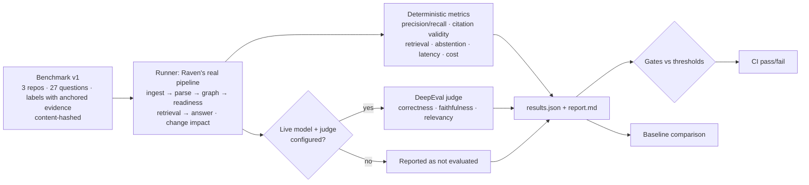
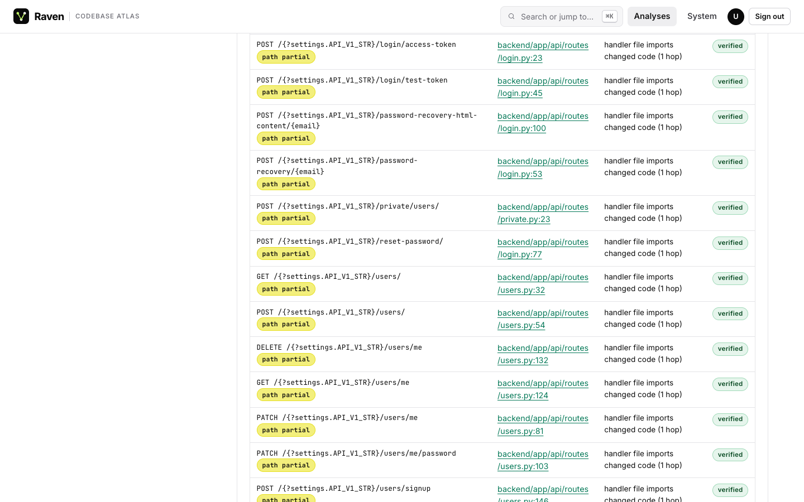

# Raven — Evaluation & Results Report

> Related: [Product](../product/PRODUCT.md) · [Architecture & Workflows](../architecture/ARCHITECTURE_AND_WORKFLOWS.md) · detailed logs: [TESTING.md](../TESTING.md), [LIMITATIONS.md](../LIMITATIONS.md)

**How to read this report.** Every result is labelled:
- ✅ **Verified** — executed in the latest pass (2026-11-25), output observed.
- 📄 **Reported** — recorded in an earlier development pass ([TESTING.md](../TESTING.md) §1–3), not re-run in the latest pass.
- ⬜ **Not verified** — implemented but never exercised against the real dependency.

Benchmark scores (precision/recall against hand-labelled ground truth) now exist for the graph, readiness findings, change impact, retrieval and the retrieval-only Q&A fallback; see §2b and [AI_EVALUATION.md](AI_EVALUATION.md). **No AI-answer accuracy figure exists**: the live-model path and the LLM judge have not been run, and none is claimed.

## 1. Environment (latest pass, 2026-11-25)
macOS (arm64) · Docker Desktop · Python 3.13 for the test and evaluation runs (the runtime image uses Python 3.12) · PostgreSQL 16 (container) · n8n 2.43.4 · an OpenAI-compatible LLM endpoint is configured but the account has **no credit**, so no live model answer was produced · a GitHub token is configured for the local stack.

## 2. Automated tests — ✅ Verified
| Suite | Command | Result |
|---|---|---|
| Backend (pytest, real PostgreSQL, schema via Alembic) | `cd backend && TEST_DATABASE_URL=… python -m pytest -q` | **490 passed, 1 skipped** (the opt-in DeepEval test) |
| Same suite in the optional DeepEval virtualenv | `.venv-eval/bin/python -m pytest -q` | 📄 not re-run since 2026-11-01 |
| Lint | `ruff check backend/app backend/tests backend/evals` | All checks passed (ruff 0.17.6) |
| Frontend unit tests (no dependencies) | `node --test frontend/tests/*.test.mjs` | **9 passed** |
| React shell checks | `cd web && npm test` · `npm run build` | **6 passed** · build OK |
| Frontend syntax | `node --check` on every `frontend/js/*.js` module | all pass |
| Workflow generation | `python automation/n8n/build_workflows.py` then `git diff` | no diff; all 3 JSON files parse |

Backend tests by area (counted with `pytest --collect-only`, 2026-11-25; the file-level map is in [testing/TESTING_LOG.md](../testing/TESTING_LOG.md)):

| Area | Tests | Covers |
|---|---:|---|
| Internal/n8n contract | 91 | idempotent dispatch, duplicate callbacks, 9×9 state-transition matrix, malformed payloads, concurrent dispatch, receipt keys reused across analyses |
| URL validation | 37 | canonicalization, look-alike hosts, encoding tricks, homoglyphs, traversal |
| Evaluation harness | 27 | metric maths, benchmark integrity, judge timeout/retry, thresholds/baselines, smoke regression |
| Frontend-file analysis + web parsing | 30 | API-call linking (never "verified"), minified exclusion, redaction |
| AI layer | 25 | provider fallback, model + prompt version, semantic retrieval, prompt-injection defences |
| Change impact | 24 | default parent base, explicit refs, hostile refs rejected before any GitHub call, isolation, rate limit |
| GitHub/LLM clients and LLM errors | 22 | status classification, redirect host allow-list, retry/backoff/repair/budget, quota-exhausted handling |
| Q&A, confidence and retrieval determinism | 21 | retrieval bounds, citation validation, rejected hallucinated citations, retrieval-only fallback |
| UI contracts | 19 | fields read by the screens, filter semantics, evidence links resolve, CSRF, ownership |
| Security API | 18 | Argon2id, cookie flags, session revocation, CSRF, rate limits, headers/CSP, body cap, internal auth |
| Graph | 17 | nested router paths, dynamic routes flagged, evidence + resolution on every edge |
| Config | 16 | production validation; `.env.example` parsing regression |
| Lifecycle | 15 | full pipeline via the exact n8n calls, ownership on every route, retries, cancel, delete cascade |
| Accounts | 15 | verification, reset, TOTP (RFC 6238 vector), recovery codes, rate limits, replay |
| Readiness | 14 | evidence mandatory, absence needs basis, security never "confirmed" |
| Defect regression | 11 | parser recovery, deterministic retrieval, SQLModel ORM, `os.getenv`, auth recognition |
| Pull-request review | 11 | drift findings, review priority, evaluation of PR reviews |
| Archive | 10 | file/size limits → partial, symlinks/traversal skipped, decompression bomb |
| Incremental indexing and tenant isolation | 9 | diff, reuse, full reindex, 11 endpoints × other user → 404 |
| Recovery + migrations | 9 | lease expiry, crash mid-pipeline, `alembic check`, downgrade/upgrade |
| Admin and quotas | 9 | admin-only API, abuse switch, daily quotas, per-route rate limits |
| Architecture drift | 8 | cycles, dependencies, boundary violations, breaking changes |
| Workflows | 7 | generator in sync, every node reachable, secrets only from n8n env |
| Map and review verdict | 7 | area classification, grouping, map endpoint, owner-only, verdict levels |
| Secrets/filters | 6 | token/PEM/JWT redaction keeps line numbers |
| Answer and embedding caches | 6 | hit across users, fallbacks never cached, disable switch |
| Monitoring | 6 | route labels, percentiles, bucket pruning, Prometheus auth |
| **Total** | **490 (+1 opt-in, skipped)** | |

These tests use fakes for GitHub and the LLM (HTTP mock transports) and emulate n8n by issuing its exact internal calls.

## 2a. How evaluation works

## 2b. Benchmark evaluation — ✅ Verified (deterministic; retrieval-only system under test)
`python -m evals run --suite smoke --repeats 3` on benchmark v1: 3 repositories, 1 of them the real `fastapi/full-stack-fastapi-template` backend; 27 questions; 5 impact scenarios. Runs:
- baseline `ab282dbf401f` (2026-10-26): 22/22 gates;
- after defect fixes 1–4, `ef5411364870` (2026-10-27): 21/22 gates;
- after fix 5, `50744a933fd3` (2026-11-01): 22/22 gates under raised floors;
- **current, `27e096d5db28` (2026-11-25): 22/22 gates, scores identical to 2026-11-01 (the suite is deterministic).**

Reports: [baseline](results/2026-10-26-smoke-retrieval-only/report.md), [fixes 1–4](results/2026-10-27-smoke-after-defect-fixes/report.md), [fix 5](results/2026-11-01-smoke-after-auth-fix/report.md), [current](results/2026-11-25-smoke-current/report.md). Detail: [AI_EVALUATION.md §9](AI_EVALUATION.md#9-results-baseline-and-after-each-round-of-defect-fixes).

| Area | Baseline | Current (n = labelled items) |
|---|---|---|
| Graph | ORM recall 0.500 · import edges recall 0.900 | **ORM recall 1.000 · import edges recall 0.990** (100); routes, data models, edge precision 1.000 |
| Readiness | rule P/R 0.882/0.882, false-positive rate 0.038 · location P/R 0.857/0.667 | **rule P/R 1.000/0.941, false-positive rate 0.000 · location P/R 1.000/0.944** (18) |
| Change impact | modules recall 0.926 · routes recall 0.868 | **modules recall 1.000 · routes recall 1.000** (precision 1.000 in both) |
| Retrieval | span recall 0.550–0.575, MRR 0.307, hit@5 0.450 | **span recall 0.608, MRR 0.366, hit@5 0.550** (20 answerable) |
| Q&A (retrieval-only fallback) | citation validity 1.000 · faithfulness 0.132 · recall 0.463 | citation validity 1.000 · faithfulness 0.148 · recall 0.560 |
| Reproducibility | retrieval differed for 5 of 27 questions across repeats | **identical across 3 repeats** |

Five defects found by the benchmark were fixed with regression tests. The fifth (`SEC-UNAUTH-MUTATION` auth recognition) only became visible after the parser fix. Three issues remain open: a re-export import, literal `getenv` fallbacks, and lexical retrieval. Small, maintainer-labelled benchmark: treat these as regression signals and diagnostics, not general accuracy.

## 3. Full-stack run with real n8n — ✅ Verified
| Check | Observed |
|---|---|
| `docker compose up -d --build` | `migrate` exited 0; `api`, `postgres`, `n8n` healthy; `worker` up |
| Health endpoints | `/health/live`, `/health/ready` (DB + migrations), `/health/orchestrator` → 200 |
| n8n workflows | 3 imported; `n8n list:workflow --active=true` lists all 3; unauthenticated POST to each webhook → **401** |
| End-to-end analysis | `fastapi/full-stack-fastapi-template` @ `b1125d8` → **READY** through real n8n (analysis + documentation workflow runs `succeeded`) |
| Q&A through n8n | `raven_codebase_qa` run `succeeded`; answer stored as retrieval-only (no LLM key) |
| Browser checks | Health filters, evidence → highlighted source line, Impact form + unknown-ref error, Ask, no horizontal scroll at 375 px on Overview/Files/Ask/Health/Impact |

**Observed output for that one repository** (single run; not a benchmark):

| Metric | Value |
|---|---|
| Files inspected / Python files parsed | 248 / 42 parsed, 1 parse failure |
| Graph | 711 nodes, 1,603 edges, 23 routes |
| Edge resolution | 1,327 verified · 48 inferred · 228 unresolved |
| Pipeline wall-clock (QUEUED → READY) | 11.3 s (fetch 1.54 s, parse 0.29 s, graph 0.66 s; no LLM calls) |
| Readiness findings | 7 (0 critical, 0 high, 2 medium, 3 low, 2 info) |
| Guide | 16 sections, status *partial* (AI unavailable; 1 unparsed file; partial route paths) |
| Impact, default base (parent) | 1 changed file (non-Python), nothing affected |
| Impact, `42b4ca0…b1125d8` (59 commits) | 58 changed files, 14 dependent modules, 23 routes, 9 potentially relevant tests, 18 frontend files, 5 removed |

### Defects found by this evaluation (fixed)
1. `.env.example` lines like `GITHUB_TOKEN=   # comment` are read by Docker Compose as the value `# comment`, so every fresh install sent a bogus token and analyses failed with `REPO_FORBIDDEN`. Fixed; regression test added.
2. The frontend `el()` helper drops raw `data-*` props: broke the Guide's table-of-contents highlight. Fixed; a test now forbids the pattern.
3. Impact page overflowed on phones; top bar overflowed on every page at 375 px. Fixed.

## 4. Reported in earlier passes — 📄 not re-run
- Playwright/Chromium browser end-to-end flows (`e2e/browser_ui_basic.py`, `browser_full_flow.py`, 14 checks) and a colour-palette audit, run on a Docker-free stack with fake GitHub/LLM servers and an n8n interpreter.
- A real GitHub tarball of the same template repository through the archive reader → parser → graph.

## 5. Not verified — ⬜
| Capability | Status |
|---|---|
| Live Anthropic API (AI explanations, AI answers, inferred-claim extraction) | Exercised only against mock transports. The "AI answer + inferred" UI was checked in the browser with a stubbed response. |
| Answer quality of AI answers (correctness, key-fact recall, abstention, faithfulness, relevancy) | Not measured. The harness supports it (`--sut live`, DeepEval judge); it was not run because no API keys were available. DeepEval's metric classes were exercised offline with a scripted judge model (wiring only). |
| Readiness / graph / impact accuracy beyond benchmark v1 | Measured only on 3 repositories (§2b); not a general estimate. |
| GitHub Actions CI (including the evaluation smoke job and the opt-in `eval-live` workflow) | Executed once on the public repository (2026-11-24): the backend job failed at the lint step because of a test-fixture import issue, fixed in commit `1021a57`; a green run is not yet recorded. `eval-live` has never run. |
| Public deployment, real HTTPS certificate, real SMTP delivery | Not done. A from-scratch image build succeeded (2026-11-25). |
| Linux Docker hosts, TLS proxy, upgrades of existing volumes | Not tested. |
| Load / concurrency beyond unit tests; accessibility audit; non-Chromium browsers | Not tested. |

## 6. Limitations (product)
- Static analysis only: dynamic imports, DI containers, reflection and runtime-generated routes can be missed; `calls` edges are not a full call graph.
- The parser runs on Python 3.12; newer syntax is reported as a parse failure (1 file in the run above).
- Only Python/FastAPI is modelled; only public GitHub repositories at default-branch HEAD.
- Secret redaction is best-effort pattern matching.
- Retrieval is lexical by default (full-text + exact match + graph neighbours); semantic retrieval is optional and unmeasured.
- Impact does not trace former dependents of deleted/renamed files; GitHub compare caps at 300 files.
- Email verification, password reset and TOTP exist but real email delivery is untested.
- The Guide still scrolls horizontally at 375 px (wide diagrams/tables).

## 7. Future improvements
1. Run `python -m evals run --suite full --sut live` with a judge, review the results, then set AI-quality floors in `evals/thresholds/full.json`. Have the benchmark labels independently reviewed and add more real repositories.
2. Re-run the Playwright suites in CI and add the new Health/Impact screens to them.
3. Execute the GitHub Actions workflow on a hosted runner; add a Docker Compose smoke job.
4. Semantic retrieval (embeddings) alongside lexical search, with the same citation validation.
5. Run the parser on the newest Python grammar to remove version-related parse failures.
6. Private-repository support via GitHub App with scoped tokens.
7. Track renames in change impact; label readiness findings with reviewer feedback to tune rules.
