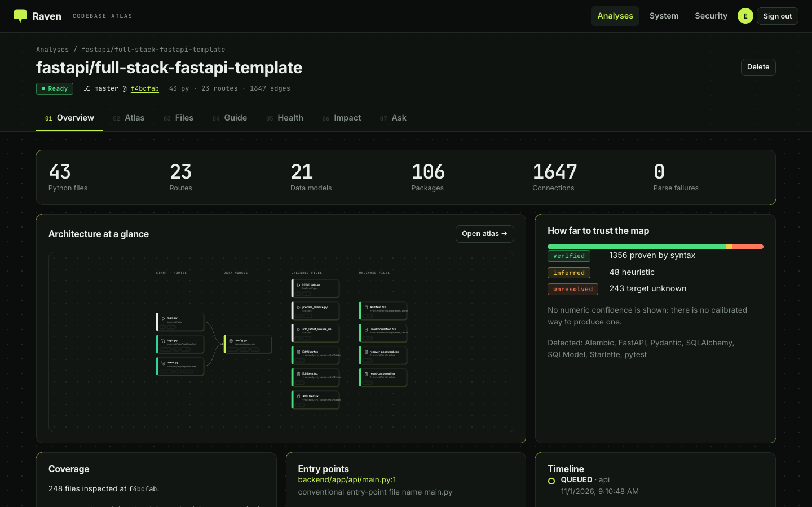
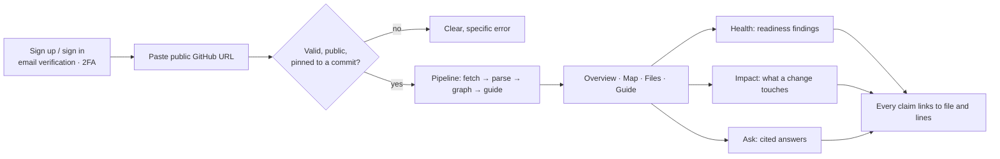
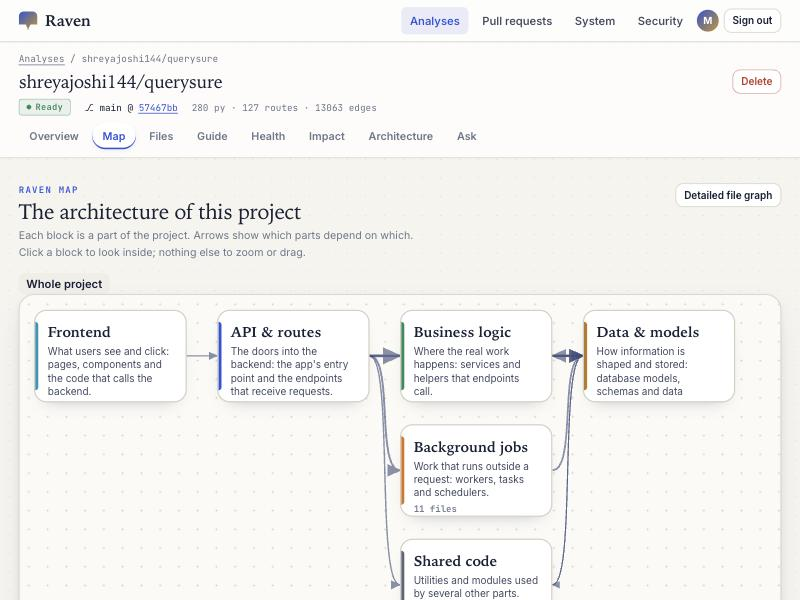
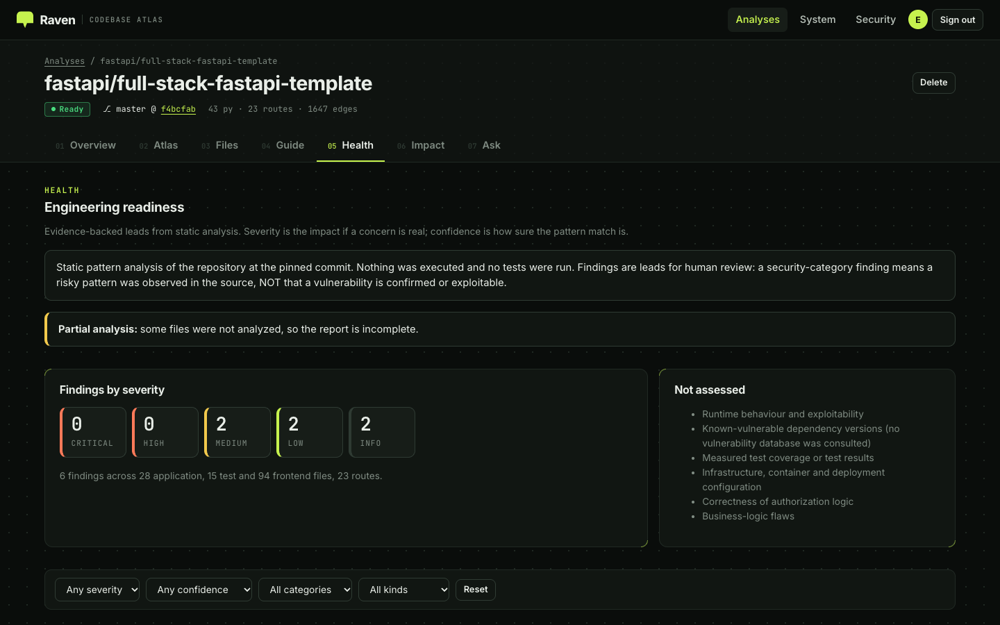
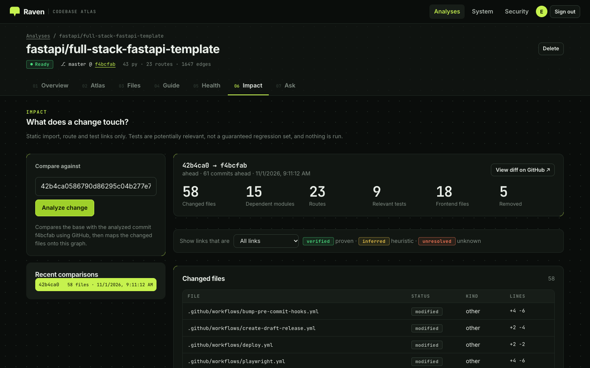
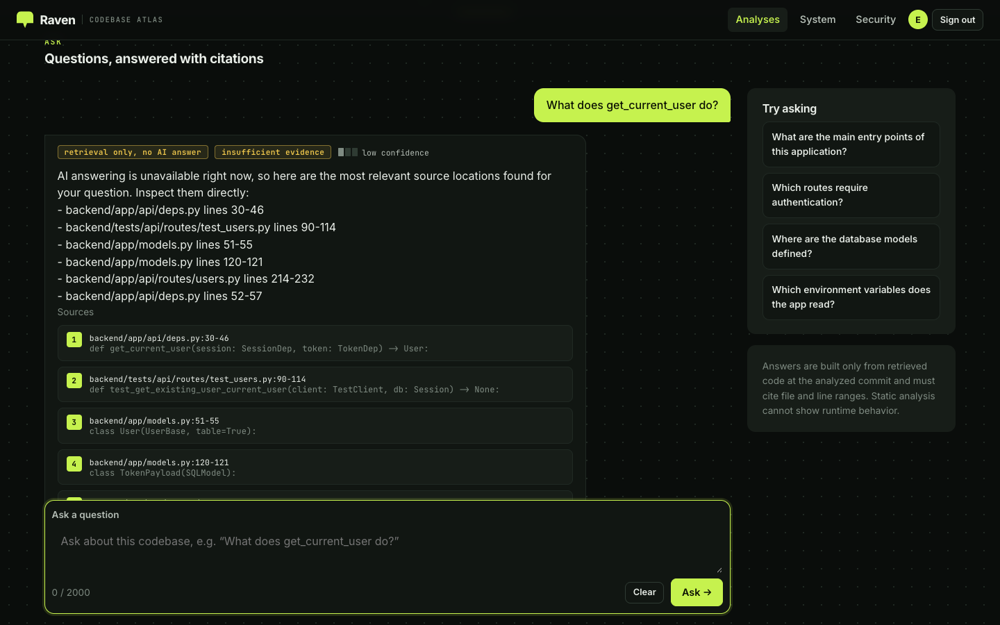
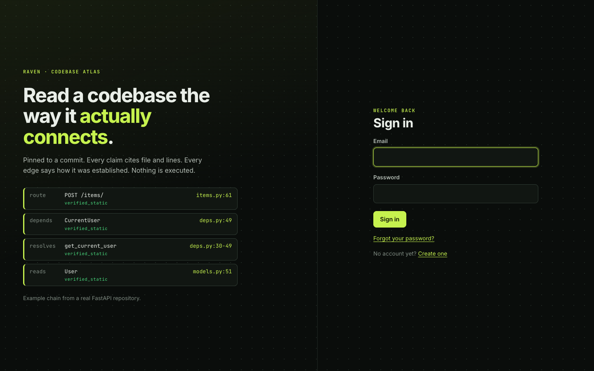
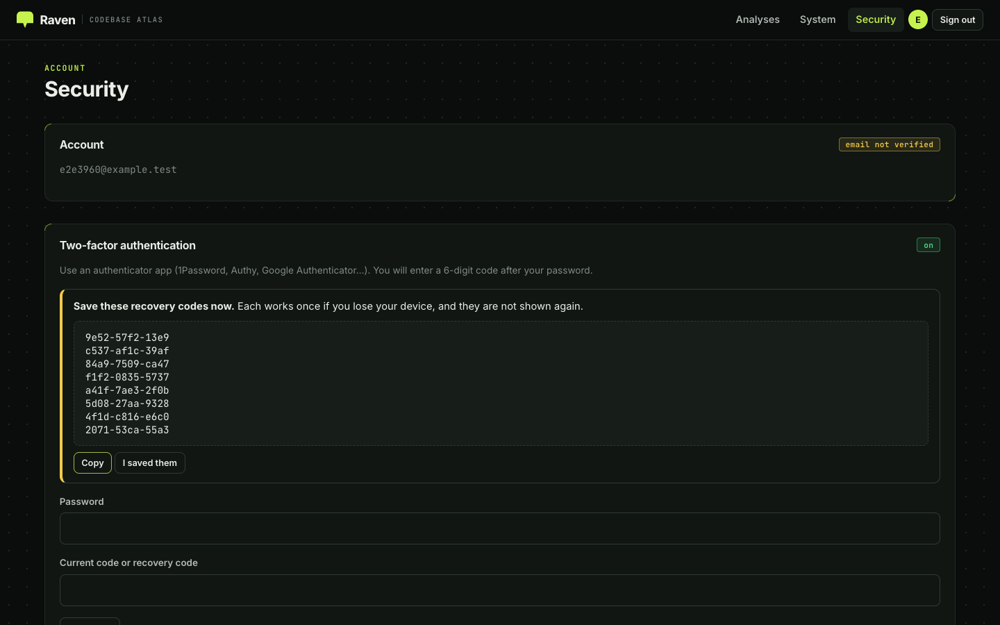

# Raven — Product Document

> Evidence-backed codebase onboarding for public Python / FastAPI repositories.
> Related: [Architecture & Workflows](../architecture/ARCHITECTURE_AND_WORKFLOWS.md) · [Evaluation & Results](../evaluation/EVALUATION_AND_RESULTS.md)

## 1. Problem
A developer joining an unfamiliar codebase spends days answering basic questions: where requests enter, which routes exist, what a change will touch, where the risky code is. Generic AI chat tools answer quickly but often cannot show *where* an answer comes from, so the developer still has to verify everything by hand.

## 2. What Raven does
Raven analyzes a **public GitHub repository at a pinned commit** with static analysis (Python `ast`; the repository is never imported or executed) and turns it into four things a new developer can act on. Every claim carries a file and line range, and every relationship says how it was established.

| Capability | What the user gets | How trust is communicated |
|---|---|---|
| **Codebase intelligence** | Architecture graph ("Map") of files, routes, models, services, workers and packages; per-route trace; source viewer; a 16-section onboarding guide | Every edge is `verified_static` (proven by syntax), `inferred` (heuristic) or `unresolved` (target unknown), with evidence lines |
| **Engineering-readiness assessment** | Findings on testing, error handling, security, configuration, logging and maintainability, each with a recommendation and "how to verify" | Separate **severity** and **confidence**; finding *kind* (`observed`, `potential_risk`, `absence`, `coverage_gap`, `metric`); security findings are never labelled "confirmed" |
| **Source-grounded Q&A** | Answers to questions about the code, with clickable citations | Citations are validated against the retrieved evidence; a **confidence** label (a rule, not a probability); claims beyond the code are listed separately as **inferred**; without an LLM it falls back to **retrieval-only** source locations |
| **Change-impact analysis** | For a base commit/branch vs. the analyzed commit: changed files, dependent modules, affected routes, potentially relevant tests, frontend callers | Each link carries its resolution; tests are "potentially relevant", explicitly not a regression set |

## 3. Users and core journey

**Primary user:** a developer onboarding onto a Python/FastAPI service. **Secondary:** a reviewer or tech lead assessing a repository.

1. Sign up, paste a GitHub URL (strictly validated; public repositories only).
2. Watch the pipeline: Queued → Fetch → Parse → Graph → Guide → Ready (retries are visible).
3. Explore: **Overview**, **Map**, **Files**, **Guide**, **Health**, **Impact**, **Ask** tabs; ⌘/Ctrl‑K command palette.
4. Follow any evidence link into the source viewer, which highlights the exact lines.

| Map (folder focus, selected file) | Engineering readiness (Health) |
|---|---|
|  |  |
| **Change impact** | **Q&A (retrieval-only mode, no LLM key configured)** |
|  |  |
| **Sign in** | **Account security (2FA)** |
|  |  |

*The Map screenshot is from the current build; the other screenshots predate the redesign. All screenshots are from the React frontend in a real local run against `fastapi/full-stack-fastapi-template` @ `b1125d8` with no LLM key configured.*

## 4. Feature detail
### Codebase intelligence
- Graph node types: repository, directory, file, module, route, function, class, model, configuration, test, external dependency, worker. Edge types: contains, imports, defines, registers_route, calls, uses_model, uses_dependency, configured_by, tested_by, starts_worker, calls_api.
- FastAPI route paths are resolved through nested `include_router` chains; dynamic prefixes are shown as *partial* (e.g. `/{?settings.API_V1_STR}/items/`) rather than guessed.
- Frontend files (`.js/.ts/.jsx/.tsx/.vue/.html/.css`) are scanned as text; API calls are linked to routes only by literal/template URL match and are never marked verified.
- Onboarding guide: deterministic Markdown (16 sections, commit-pinned citations). AI prose is optional, labelled, and validated; without an LLM the guide is marked *partial*.

### Engineering-readiness assessment (Health)
- Filters: severity, minimum confidence, category, kind. Evidence chips open the exact source line.
- Pattern findings without file:line evidence are dropped; absence findings must say what was searched.
- Includes a fixed "not assessed" list (runtime behaviour, dependency CVEs, measured coverage, infrastructure, authorization correctness, business logic).

### Source-grounded Q&A (Ask)
- Retrieval: exact symbol/route/path matches, PostgreSQL full-text search, 1-hop graph neighbours; bounded to ≤12 snippets / ≤400 lines.
- The model may only cite supplied snippets; out-of-range or invented citations are rejected (one repair attempt).
- Confidence: **high** = a validated citation overlaps a direct match and nothing is inferred; **medium** = cited but indirect or with inferred claims; **low** = insufficient evidence or retrieval-only.

### Change impact (Impact)
- Default base is the analyzed commit's first parent; any branch, tag or SHA can be entered (strict ref validation, rate-limited).
- Reverse-import closure to depth 3, route handlers in affected files, tests linked by import or naming convention, frontend callers of affected routes, a change-neighbourhood graph, and a history of the last 20 comparisons.

### Accounts (public sign-up readiness)
Email verification (enforceable), password reset by single-use emailed link (revokes all sessions), TOTP two-factor with hashed single-use recovery codes. Real SMTP delivery has not been tested.

### Deployment options
Docker Compose with optional profiles: Caddy HTTPS proxy, daily backup with housekeeping, webhook health monitor. See [DEPLOYMENT](../DEPLOYMENT.md).

## 5. Scope and non-goals
- **In scope:** public GitHub repositories, default-branch HEAD, Python/FastAPI modelling (other Python frameworks: modules/imports only).
- **Not in scope:** running code or tests, vulnerability scanning against CVE databases, private repositories, general "AI accuracy" claims. Benchmark-scoped scores for the graph, readiness, impact and retrieval are in [AI_EVALUATION.md](../evaluation/AI_EVALUATION.md); AI-answer quality has not been measured yet.

## 6. Roadmap
Planned order (see [Sprints](../sprints/SPRINTS.md)): live-model evaluation with a judge and AI-quality floors → CI executed on GitHub → public HTTPS deployment → prompt-injection test set → OpenTelemetry and metrics → GitHub App (private repositories, PR comments) → SSO and organisations.

## 7. Status
MVP. Verified end-to-end on a local Docker Compose stack with real n8n; the LLM path has only been exercised against fakes. See the [Evaluation & Results Report](../evaluation/EVALUATION_AND_RESULTS.md) for exactly what was and was not verified, and [Future improvements](../evaluation/EVALUATION_AND_RESULTS.md#7-future-improvements).
