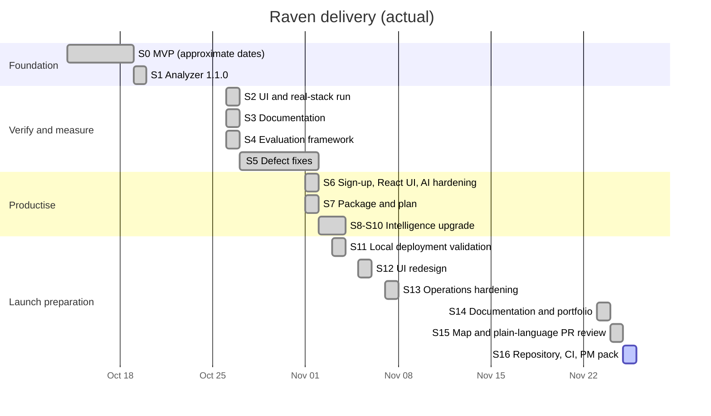

# Roadmap

| | |
|---|---|
| Version / date | 1.0 · 2026-11-25 |
| Related | [Milestones](04-MILESTONES.md) · [Backlog](05-PRODUCT-BACKLOG.md) · [Sprint history](../sprints/SPRINTS.md) |

## 1. Delivered (S0–S16, 2026-10-14 to 2026-11-25)

Dates before S8 are approximate (see [SPRINTS.md](../sprints/SPRINTS.md)). S9 is dated to the day migration `0006` landed; the work around it ran 2026-11-02 to 2026-11-03.

## 2. Next, Now / Next / Later
Priorities follow the [backlog](05-PRODUCT-BACKLOG.md) (MoSCoW). No dates are committed: there is no deadline and the first two items depend on an LLM account being funded.

| Horizon | Item | Backlog | Why |
|---|---|---|---|
| **Now** | Record a green GitHub Actions run | B-02 | The first run failed at lint and was fixed; the pipeline is the proof the tests run elsewhere |
| **Now** | One successful live AI answer, then the benchmark with the judge | B-01 | The biggest unverified claim: answer quality with a real model |
| **Now** | Refresh the running local stack from the from-scratch image | B-03 | The running images were layered during a network outage |
| **Next** | Hosted demo on a small server with HTTPS, spend limits and real email | B-04, B-05 | A live link for reviewers; needs a domain and SMTP |
| **Next** | Five developer interviews on the Map and the pull-request page | B-09 | The core claim is still a hypothesis |
| **Next** | Alert thresholds on error rate, queue age and AI fallback rate | B-06 | The numbers exist; nothing watches them |
| **Later** | Semantic retrieval measured, then pgvector at scale | B-08 | Retrieval is the weakest measured area (hit@5 0.55) |
| **Later** | Private repositories through a GitHub App; posting review comments | B-12, B-13 | Larger audience; needs scoped credentials |
| **Later** | More languages; SSO and organisations | B-14, B-15 | Only after the FastAPI case is proven with users |

## 3. Roadmap principles
1. Verify before extending: no new capability while an existing claim is unverified.
2. Every feature ships with evidence (a test, a benchmark change or an observed run).
3. Cuts are recorded, not forgotten ([PRD §6](02-PRD.md#6-what-was-cut-and-why)).
