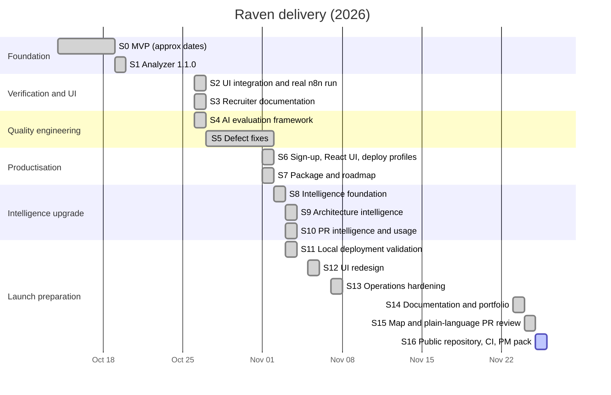
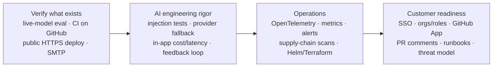
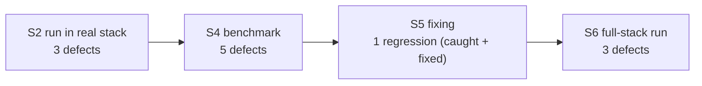

# Raven — delivery history in sprints

> Related: [Product](../product/PRODUCT.md) · [Architecture](../architecture/ARCHITECTURE_AND_WORKFLOWS.md) · [Evaluation](../evaluation/EVALUATION_AND_RESULTS.md) · [Testing log](../testing/TESTING_LOG.md)

Reconstructed from the changelog, migration dates, file timestamps and the working record of each pass. Sprint 0–1 dates are approximate (from file timestamps); later sprints use migration dates, backup timestamps, the changelog and the working record. Test counts are the backend `pytest` totals recorded at the end of each sprint.

## At a glance
| Sprint | Goal | Backend tests at end | Headline result |
|---|---|---:|---|
| S0 | Working MVP: analyze a public FastAPI repo, graph, guide, cited Q&A | 250 | Orchestrated by n8n, state and queue in PostgreSQL; verified against fakes and an n8n interpreter |
| S1 | Analyzer 1.1.0: readiness report, change impact, Q&A confidence, frontend linkage | 320 | API-only features, migration `0002` |
| S2 | Make S1 visible and prove the stack | 347 | Health/Impact/Ask screens; **first run in real n8n under Docker** |
| S3 | Recruiter-ready docs | 347 | 4 documents, diagrams, real screenshots |
| S4 | Measure Raven instead of asserting it | 373 | Benchmark v1 + harness; **found 5 real defects** |
| S5 | Fix what the benchmark found | 387 | 22/22 gates; every metric improved or equal except one regression found and fixed |
| S6 | Public sign-up readiness | 403 | Email verification, reset, TOTP 2FA, React UI, HTTPS/backup/monitor profiles |
| S7 | Package and plan production grade | 403 (428 after the same-day AI hardening) | Documentation package; roadmap |
| S8 | Hybrid retrieval, commit-aware answers, incremental indexing, tenant isolation | not recorded separately | Migration `0005` |
| S9 | Architecture snapshot, drift between commits, predicted impact | not recorded separately | No migration |
| S10 | Pull-request review, token and latency accounting | 462 at the S11 validation | Migration `0006` |
| S11 | Prove the whole stack locally: migrations, API, worker, n8n, real database | 462 | Found and fixed a dispatch stall (idempotency receipts reused across analyses) |
| S12 | Redesign landing, sign-in and workspace | 462 | Node-graph workspace with zoom, pan, fit, minimap |
| S13 | Admin console, quotas, caches, monitoring, security headers | 483 | Migrations `0007`, `0008` |
| S14 | Recruiter documentation, portfolio guide, case study | 483 | API, configuration, operations docs |
| S15 | Architecture-first Map, plain-language PR review, fewer false alarms | 489 | Users could not read the old canvas; PR review contradicted another reviewer |
| S16 | Public repository, CI fix, project-management pack | 490 | Repository connected; first CI run failed on lint and was fixed |

## S0 — MVP
**Goal:** a developer pastes a public GitHub repo and gets an evidence-backed map.
**Delivered:** FastAPI API with sessions/CSRF/ownership checks; Python worker with a PostgreSQL queue (`SKIP LOCKED`, leases); three generated n8n workflows; static analysis with Python `ast`; graph with verified/inferred/unresolved edges; onboarding guide (14 sections then, 16 now); cited Q&A with retrieval-only fallback; vanilla-JS UI with an interactive Map; Docker Compose; 250 backend tests; Docker-free Playwright flow.
**Not verified at the time:** real n8n, Docker build, live GitHub, live LLM.

## S1 — Analyzer 1.1.0
**Delivered:** frontend files scanned as text and linked to routes (never marked verified); engineering-readiness report (severity and confidence kept separate; evidence mandatory); change impact (GitHub compare mapped onto the graph); Q&A `confidence` label and separate `inferred` list; migration `0002`.
**Carried over:** no UI for the new features; workflows and Docker still unverified.

## S2 — UI integration and real-stack proof
**Delivered:** Health (filters, evidence → exact source line), Impact (base picker, tables, graph, history), Ask (confidence + inferred shown apart from cited answer); DOM-free helpers with unit tests; 27 new tests (API contracts, workflow validation, config).
**Verified:** full Docker Compose stack, all health checks, three workflows active in **real n8n 2.43.4**, one real repository analysed end to end.
**Found and fixed by running it:** `.env.example` inline comments made Docker Compose send a bogus GitHub token (every analysis failed `REPO_FORBIDDEN`); a helper silently dropped `data-*` attributes (broken guide highlight); phone-width overflow.

## S3 — Recruiter documentation
**Delivered:** product, architecture and evaluation documents, README, 11 real screenshots, a verified-vs-untested convention (✅ / 📄 / ⬜), a clean ZIP.

## S4 — AI evaluation framework
**Delivered:** `backend/evals` harness (`validate`, `run`, `report`, `verify-sources`); benchmark v1 (3 repos incl. one real, 27 questions of which 7 unanswerable, 30 routes, 100 import edges, 5 impact scenarios); deterministic metrics; optional DeepEval judge kept out of the runtime dependencies; threshold gates, baseline comparison, CI smoke job and an opt-in live workflow.
**Found:** five Raven defects (unparseable newer syntax dropping a whole file, non-deterministic retrieval, SQLModel ORM misclassification, `os.getenv` misrule, line-count off-by-one).

## S5 — Defect fixes
Each fix has a regression test that failed first.
| Fix | Before → after (smoke suite, retrieval-only) |
|---|---|
| Tolerant parsing with exact line numbers and honest reporting | import-edge recall 0.90 → 0.99 |
| Deterministic retrieval (stable tie-breakers) | outputs differing between repeats: 5 → 0 |
| SQLModel `table=True` through a base class | ORM recall 0.50 → 1.00 |
| `os.getenv` rule, trailing-newline line counts | readiness rule precision 0.88 → 1.00 |
| `SEC-UNAUTH-MUTATION` auth recognition (exposed by fix 1) | location precision 0.67 → 1.00 |
**Regression caught by the harness itself:** empty files produced "lines 0–0" evidence (citation validity 0.966); fixed with a test. Thresholds were only ever raised.

## S6 — Public sign-up, React UI, deploy profiles
**Delivered:** email verification, password reset, TOTP 2FA with recovery codes (migration `0003`, 15 tests); React + Vite + plain CSS frontend reusing the graph engine; Caddy HTTPS, backup and monitor Compose profiles.
**Verified:** full-stack browser run (register → analyze → every tab → 2FA setup and login → recovery code), backup **restore** with matching row counts, Caddy config validation.
**Found and fixed by running it:** Compose required `RAVEN_DOMAIN` even with the proxy profile off; backup housekeeping used wrong table/column names; mobile overflow on logged-in pages.

## S6 addendum — AI hardening and auth recognition (same day, 2026-11-01)
Second provider and fallback model, optional semantic retrieval, model and prompt versioning (migration `0004`), a prompt-injection suite, and the `SEC-UNAUTH-MUTATION` auth-recognition fix (S5 fix 5). Backend tests 403 → 428. See [CHANGELOG](../../CHANGELOG.md).

## S7 — Package and production-grade plan

**Next sprint candidates, in order:** (1) live-model evaluation with the judge and AI-quality floors; (2) CI executed on GitHub; (3) public deployment on a Linux host with a real certificate and SMTP; (4) prompt-injection test set; (5) OpenTelemetry + Prometheus.

## Defects found by verification, by sprint

Every defect above was found by *running* something against real data, not by reading code, which is the working method of the whole project.

## S8 — Intelligence foundation (2026-11-02)
Hybrid retrieval with separable lexical, semantic and graph channels; `commit_sha` on answers, citations and findings (migration `0005`); incremental indexing against the owner's previous analysis; full reindex; tenant-isolation and no-LLM tests. Plan and evidence: [UPGRADE_PLAN](UPGRADE_PLAN.md).

## S9 — Architecture intelligence (2026-11-03)
Per-commit architecture snapshot, drift between commits (new dependencies, import cycles, boundary violations, coupling, complexity, breaking changes), history and predicted impact; Architecture tab.

## S10 — Pull-request intelligence and usage (2026-11-03)
Pull-request review from two analyses, `GET /analyses/{id}/usage` token/latency/cost accounting, migration `0006`, `python -m evals pr`.

## S11 — Local deployment validation (2026-11-03)
Goal: prove the whole stack before any public step. A database backup was taken, migrations `0005`/`0006` were applied to the real database, and API readiness, worker, PostgreSQL, n8n, analysis, retrieval-only Ask, Architecture and PR review were exercised. Backend tests: 462 passed, 1 skipped.
**Found and fixed:** n8n reuses execution ids, so an idempotency receipt from one analysis was replayed for another and dispatch stalled for about 95 seconds; receipts are now namespaced by analysis id (regression test added).

## S12 — UI redesign (2026-11-05)
Cinematic landing and sign-in, light workspace, node-graph canvas with pan, zoom, fit, reset and minimap, floating contextual panels, compact top navigation. Browser-verified on the running stack; web tests 6 passed.

## S13 — Operations hardening (2026-11-07)
Admin role, abuse switch and audit trail (migration `0007`); per-user daily quotas and per-route rate limits; commit-keyed answer cache and question-embedding cache (migration `0008`); monitoring dashboard and Prometheus endpoint; extra security headers. Backend tests 483. Details: [ADMIN_AND_OPERATIONS](../ADMIN_AND_OPERATIONS.md).

## S14 — Documentation and portfolio (2026-11-23)
API reference, configuration reference, operations guide, portfolio guide and case study; benchmark re-run (22 of 22 gates).

## S15 — Map and plain-language PR review (2026-11-24)
Feedback from reviewing the product on a real repository: the canvas was hard to navigate (scroll did not pan), the all-files graph was unreadable, and the pull-request review said "high risk" while another reviewer disagreed.
**Delivered:** architecture-first Map (areas → groups → files), scroll-to-pan canvas, rewritten pull-request page, and fixes for three false alarms (deleted tests counted as breaking API; removed functions that nothing used rated high; scripts classified as API).

## S16 — Public repository, CI and project-management pack (2026-11-25)
Repository connected to GitHub and the earlier prototype's files replaced (history kept); first GitHub Actions run failed at lint and was fixed (`1021a57`); this project-management pack and a documentation consistency check were added. See [project/README.md](../project/README.md).
